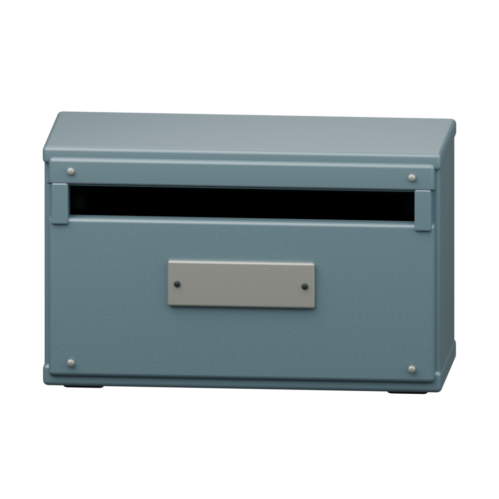
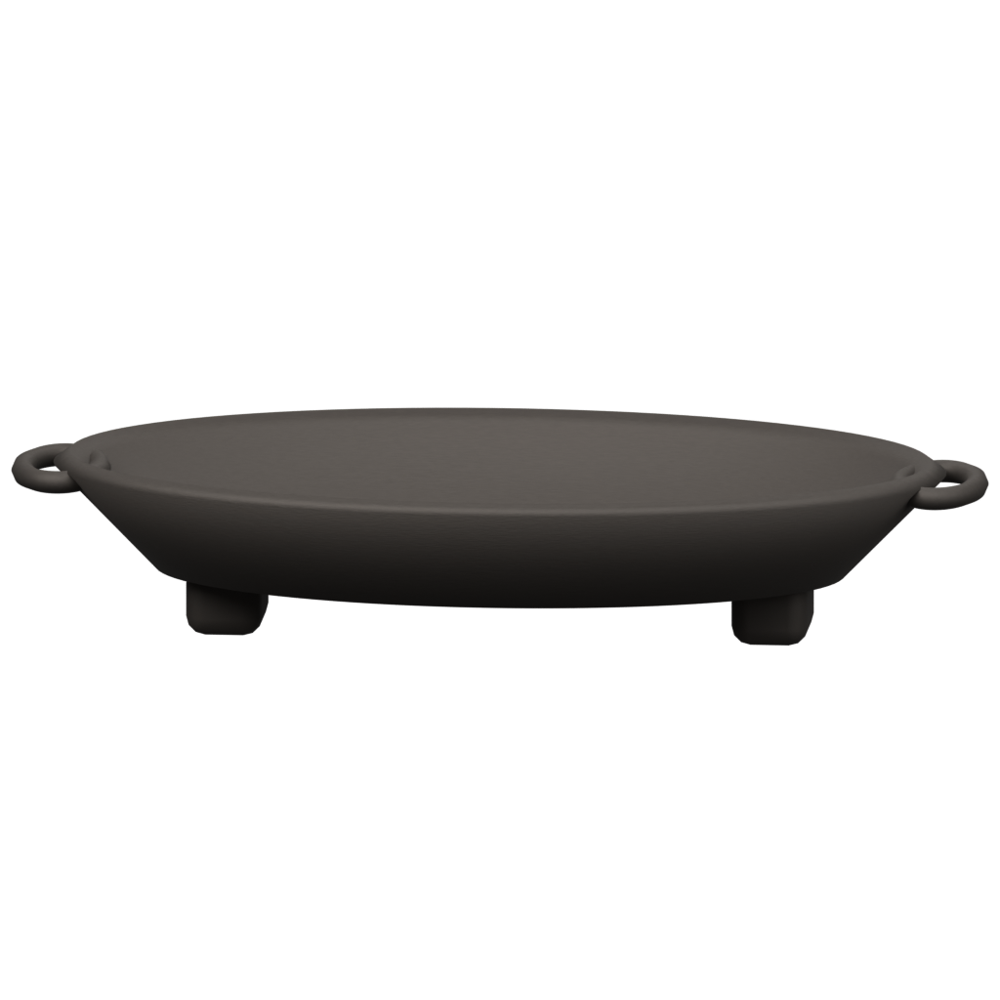

# Media Operator

Media Operator 是跑在 Windows 上的本地桌面程序。它把本机文件，以及 YouTube、Bilibili、抖音、小红书、小宇宙的链接或分享文案，做成带字幕的视频，可以投稿到 B 站，也可以把原话整理成 Obsidian 笔记。0.5 的界面是一个双信箱工作台：首页同时收「投稿」和「笔记」。转录在本机完成。DeepSeek 翻译、投稿文案和观点摘录是可选项。

当前版本 **0.5.0**。版本号以仓库根目录的 [`VERSION`](VERSION) 为准。`main` 分支仍停在 0.4.1，日常开发在 `dev`。

## English summary

Media Operator is a Windows desktop app. It turns local files and links from YouTube, Bilibili, Douyin, Xiaohongshu, and Xiaoyuzhou into subtitled videos, can upload those videos to Bilibili, and can file source-grounded notes into an Obsidian vault. Version 0.5 is a workbench with two inboxes, one for publishing and one for notes. Transcription runs locally. DeepSeek is optional. The maintained line is `dev` at 0.5.0; `main` is an older 0.4.1 release.

## 能做什么

- **投稿信箱**：贴上链接、分享文案或本地路径。识别标题和站点之后，备齐输出、字幕样式、投稿信息和翻译上下文，再开始处理。
- **处理流水线**：下载或导入素材，用 faster-whisper 转录，按需要调用 DeepSeek 翻译，用 FFmpeg 把字幕烧进画面，再投稿到 B 站。
- **笔记信箱**：同一条素材可以整理成带时间戳的观点卡片，核对后写入 Obsidian。已有的下载、字幕和译文可以复用。
- **本机优先**：桌面窗口只连接 `127.0.0.1` 上的一次一密会话。密钥放在 Windows 凭据管理器里。资料目录由使用者自己选。

工作台用信纸、信封和火盆来表示投递与处理。下面两张是界面里的插画素材，不是运行截图。





## 架构

```text
desktop_entry.py
    └─ app/desktop.py          pywebview 窗口，仅绑定 127.0.0.1，Cookie 会话
           ├─ app/main.py      配置、请求模型和对外名字
           │    └─ app/stages/ 下载、转录、翻译、烧录、B 站投稿、HTTP API
           ├─ app/desktop_routes.py
           ├─ app/workbench_inbox.py    双信箱队列
           ├─ app/desktop_jobs.py       阶段调度与断点
           └─ app/whisper_worker.py     单独的转录进程

frontend/                      React 工作台
    └─ 构建到 app/static/desktop-ui/，由桌面包进安装目录
```

`app/stages/` 里的文件在导入时执行进 `app.main`。桌面程序、转录进程和测试继续 `import app.main`，并在这个模块上替换路径或函数。桌面另有一套只接受本机来源的会话，见 `app/desktop.py`。无界面服务可以由 Docker Compose 启动，它没有这套会话。

支持的站点解析在 `app/sites/` 和 `app/desktop_sources.py`。Obsidian 写入在 `app/obsidian.py`。

## 技术栈

| 部分 | 选用 |
| --- | --- |
| 桌面壳 | Python 3.12、pywebview、WebView2、PyInstaller、Inno Setup |
| 服务 | FastAPI、uvicorn、pydantic |
| 媒体 | FFmpeg、ffprobe、yt-dlp、Deno、faster-whisper、ctranslate2 |
| 投稿 | bilibili-api-python |
| 界面 | React 19、TypeScript、Vite |
| 可选云端 | DeepSeek 对话接口，用于翻译、投稿字段和观点摘录 |

## 开发与测试

桌面程序的构建和安装只在 Windows 上完成。步骤、环境变量和安装核对写在 [docs/DESKTOP_QUICKSTART.md](docs/DESKTOP_QUICKSTART.md)。打包脚本是 `scripts/build_desktop.ps1`，路径通过参数传入。

无界面服务默认只听本机。`python -m app.main` 和 `scripts/serve_api.sh` 在 `MEDIA_BIND_HOST` 不是回环地址、又没有 `MEDIA_API_TOKEN` 时会直接退出。令牌配上之后，请求要带 `Authorization: Bearer <token>` 或 `X-Media-Token`。桌面窗口不走这条路：它自己绑定 `127.0.0.1`，用一次性 Cookie，不读取这个令牌。

```bash
python -m venv .venv
.venv/bin/pip install -r requirements.txt
cp .env.example .env
# 编辑 .env 后再启动。
.venv/bin/python -m app.main
```

开发依赖在 `requirements-dev.txt`。检查是 `ruff check app tests desktop_entry.py` 和 `python -m pytest -q`。GitHub Actions 会在 Ubuntu 上跑这两项和前端构建，并在 Windows 上再跑一遍 pytest，好让桌面测试也被收集。

Docker Compose 的示例在 `docker-compose.yml`，端口只发布到 `127.0.0.1`。要把容器暴露到别的网卡，先设置 `MEDIA_API_TOKEN`，再把 `MEDIA_BIND_HOST` 改成 `0.0.0.0`。把密钥留在环境变量或桌面设置里，不要提交 `.env`。

前端：

```bash
cd frontend
npm ci
npm run build
```

Python 测试在 `tests/`。其中 `tests/test_desktop.py` 只在 Windows 上收集。

## 仓库里还有什么

- [`AGENTS.md`](AGENTS.md) 是给改代码的代理看的打包约定，路径用环境变量。
- [`packaging/THIRD_PARTY.md`](packaging/THIRD_PARTY.md) 和 [`frontend/THIRD_PARTY.md`](frontend/THIRD_PARTY.md) 记录随包组件的许可。
- [`docs/archive/VALIDATION-0.3.0.md`](docs/archive/VALIDATION-0.3.0.md) 是 0.3.0 的历史验证笔记，不是当前版本的结论。

## 许可

本仓库源码使用 [MIT License](LICENSE)。安装包另外带有 FFmpeg、字体和 Python 依赖自己的许可，见 `packaging/THIRD_PARTY.md`。
